# AI 酱语音 · AI Buddy Voice

<p align="center">
  <a href="https://github.com/lXiaoSel1/AI-Buddy-Voice/releases"></a>
  
  
  
  <a href="LICENSE.md"></a>
</p>

**简体中文** · [English](#english)

[AI 酱本体](https://github.com/lXiaoSel1/AI-Buddy) · [B站陪伴](https://github.com/lXiaoSel1/AI-Buddy-Bilibili) · [QQ连接](https://github.com/lXiaoSel1/AI-Buddy-QQ) · [一起玩牌](https://github.com/lXiaoSel1/AI-Buddy-Card-Games) · **语音**（本仓库）

**当前版本：1.0.3** · 需要 [AI 酱](https://github.com/lXiaoSel1/AI-Buddy) 2.0.14 或更新。这是 AI 酱的官方插件，在 AI 酱的 **扩展中心** 里安装，不用单独下载。之前装过旧版的话，升级到 AI 酱 2.0.14 后可以继续用兼容的旧版，也可以在 **扩展中心 → 更新与维护** 里更新到 1.0.3。AI 酱 2.0.14 支持语音接口大版本 1，不再逐个列举补丁号；1.x 插件仍需满足 `appRange` 的最低本体要求，并通过接口、同版本共用组件等兼容与信任检查。2.0.13 已经撤回，在它上面 1.0.3 装好也启用不了。

让 AI 酱里的角色开口说话。她的回复会用她自己的声音读出来，文字跟着播放进度出现；你也可以开 Live 和她轮流说话，或者录一段话转成文字、改好再发。本仓库是两个语音插件 **Breeze 语音** 和 **GPT-SoVITS 语音** 的源码，它们共用一个内部组件。

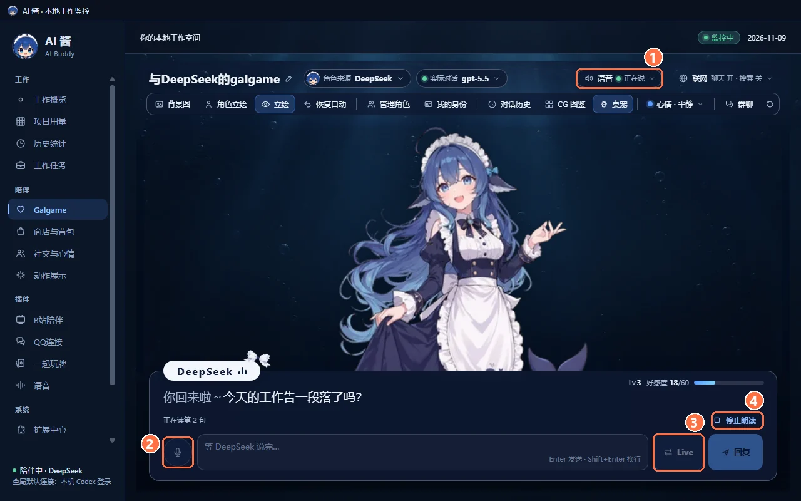

## 能做什么

- **读出她的回复**：私聊、群聊和一起玩牌里都能用。配音的回复按实际播放进度显示，已经读完的部分会变暗；配音失败或超时后，文字照常显示（牌桌上最多等 15 秒）。
- **Live 轮流说话**：你说一句，她回一句；进度条显示你说、识别、她想、她说四个阶段。
- **录音输入**：说完以后，识别出的文字放进输入框，可以先改再发，不会自动发送。
- **11 位角色的预制声音**：两个插件各带 11 档，安装后自动导入，保留已有的声音选择和自定义录音。也可以换成你自己准备的录音。录音默认只存在这台电脑上，只给这位角色用；只有你明确同意云端克隆时才会上传。
- **本机或云端**：默认在这台电脑上配音，不上传、不花钱；不想占显卡时可以改用 MiniMax 云配音，按字数计费。
- **牌桌喊话**：在一起玩牌里，她们会用合成语音喊出「All in」「三条」这类话，牌桌的声音菜单里有单独的语音音量。

## 选哪个插件

两个插件装一个就够，也可以都装。它们共用同一套语音识别，同一时间只运行一个本机配音引擎：换成另一个时，会先停掉当前这个，再启动新的。显存门槛只是启动检查，不保证每台电脑都能加载成功。

| | Breeze 语音 | GPT-SoVITS 语音 |
|---|---|---|
| 语气 | 能跟着情绪变语气 | 只有平静的语气 |
| 显卡 | NVIDIA（CUDA），启动时至少 9.5 GiB 空闲显存 | NVIDIA（CUDA），启动时至少 4 GiB 空闲显存 |
| 第一次准备时下载（含共用的语音识别，十进制 GB） | 约 11.18 GB | 约 6.92 GB |
| 参考录音 | 一段平静语气、只有一个人说话的录音 | 同左，长度 3–10 秒 |
| 用途限制 | 模型和生成的声音只限研究和非商业用途，商业用途要另外取得书面许可，见[来源和许可](#来源和许可) | 见各组件的许可说明 |

两个插件都可以改用 **MiniMax 云配音**。云端模式只准备共用组件，不需要本机的声音模型和显卡。

## 快速上手

**1. 安装。** 在 AI 酱左侧栏打开 **扩展中心 → 发现**，在「Breeze 语音」或「GPT-SoVITS 语音」右边点 **安装…**。插件包（含预制参考）Breeze 约 8 MB、GPT-SoVITS 约 11 MB，安装后会自动导入对应的 11 档预制声线，已有设置保持不变。声音模型要等第一次启动时才准备。

**2. 打开语音插件页。** 左侧栏 **插件 → 语音**。也可以在 **扩展中心 → 已安装** 里点「启动」或「打开」，或者直接在 Galgame 顶栏打开语音，插件会自动启动。

下图是本机配音、组件都已就绪时的样子；组件没准备好时会先显示准备页，改用 MiniMax 云端时会显示云音色管理。

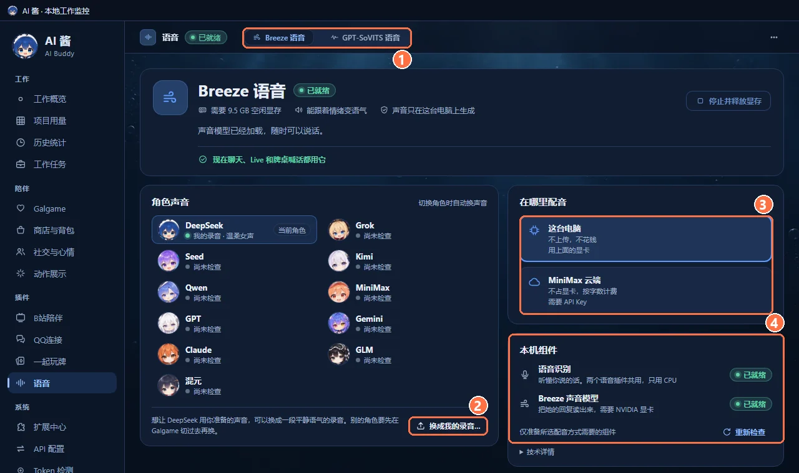

1. 顶部切换 Breeze 和 GPT-SoVITS 的页面。只是看，不会切换正在用的引擎。
2. **角色声音**：每位角色的声音和状态。点 **换成我的录音…** 给当前角色换声音，见第 4 步。
3. **在哪里配音**：「这台电脑」或「MiniMax 云端」。
4. **本机组件**：语音识别和声音模型是否就绪。

**3. 准备组件。** 第一次用时，本机组件会显示「需要准备」。点 **下载** 开始下载，会显示进度，离开这一页也会接着下。只下载你选的那个引擎和共用的语音识别，不会顺带下载另一个引擎。

从 AI 酱 2.0.12 起，如果插件更新后用的还是同一套组件、文件也都在这台电脑上，这一行会显示「需要校验」。点 **下载** 旁边的 **校验** 就行，不会重新下载；校验发现文件缺了或内容不对，再点 **下载**；提示校验被中断，或者校验时文件有变动，点 **重新校验**。AI 酱 2.0.14 修好了文件没问题却校验失败的情况；校验中途取消或失败时，已经核对过的文件下次不用重来。

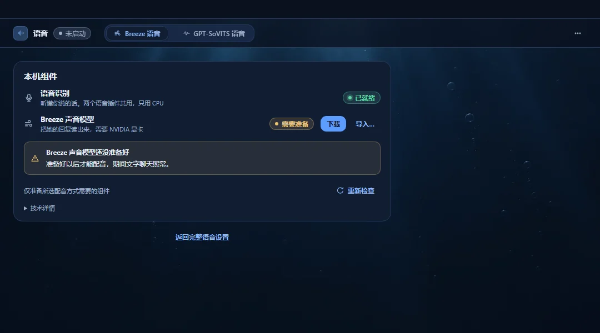

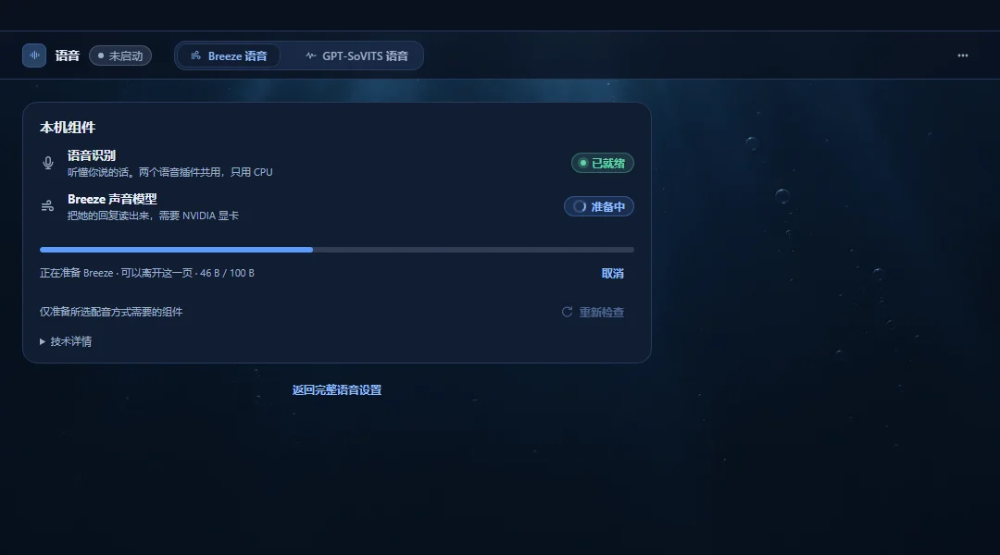

**4. （可选）换成你的录音。** 先在 Galgame 里切到想换声音的角色，再回到插件页点 **换成我的录音…**：填上录音里说了什么，点 **换成这段录音**，选一段语气平静、只有一个人说话的 WAV 录音。GPT-SoVITS 的录音要 3–10 秒，这是模型本身的要求，导入时 AI 酱不会替你检查长度。请只用你有权使用的录音。

从 AI 酱 2.0.12 起，角色有两份以上的声音时，**换成我的录音…** 左边会出现 **她的声音** 下拉，随时可以换回「预制声线」或别的录音。如果她正在说话，这一句会停下，下一句开始用新声音。

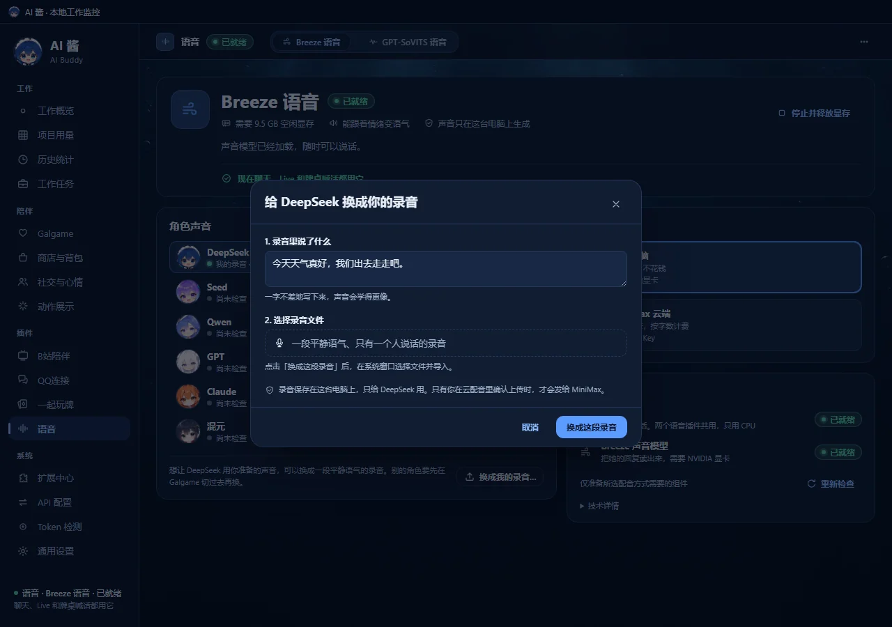

**5. 在聊天里用。** Galgame 顶栏右侧的 **语音** 显示现在的状态；点开可以开关语音、切换配音插件和配音位置。

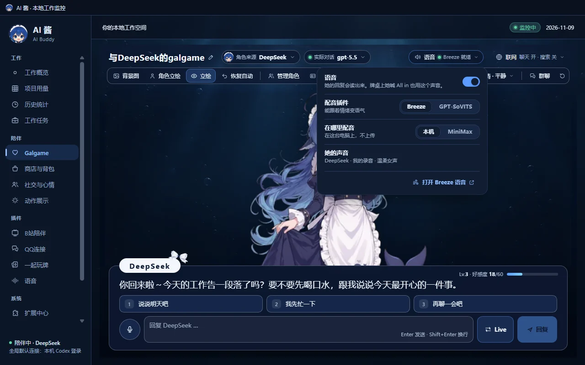

## Live 和录音输入

点输入框右边的 **Live**，你说一句、她回一句，她说完会自动轮到你。点 **结束 Live** 只结束 Live，不会再发一条消息。

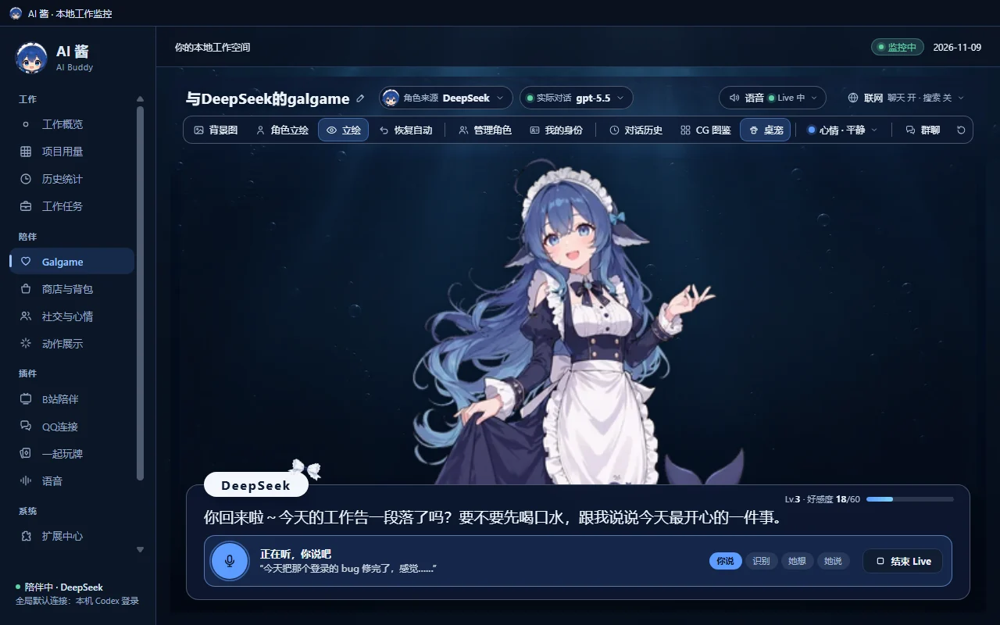

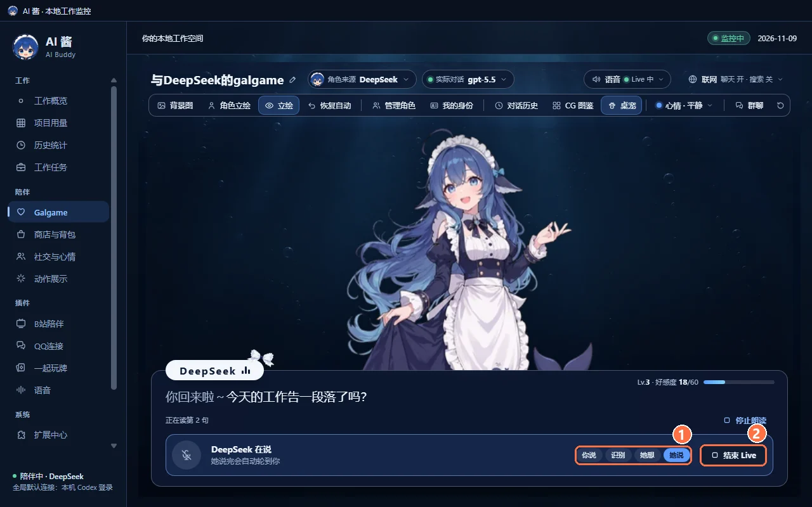

- Live 和录音输入都要 Windows 允许 AI 酱使用麦克风。被拒绝时会提示你去系统设置里允许。
- 点 Live 后会先准备好需要的组件再打开麦克风，这期间可以先打字；声音模型还在加载时，Live 按钮不能点。
- 配音失败或回复没能开始时，Live 可能会退出，需要再点一次；已经保存的回复不会丢。
- 私聊和群聊之间切换，或者离开 Galgame 页面，不会自动替你重新打开麦克风。

输入框左边的话筒是 **录音输入**：说完以后，识别出的文字放进输入框，标着「来自录音」，可以先改再发。取消会保留你原来输入的内容。

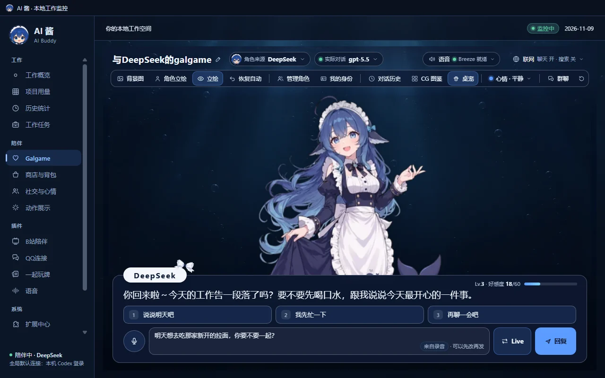

## 群聊和牌桌

群聊用同一个语音入口，正在说话的角色用她自己的声音；群聊 Auto 会等当前这句的文字和声音呈现完，再轮到下一位，停止或出错时也会放行。私聊和群聊之间切换时，会停掉正在读的那一句，语音开关保持不变。

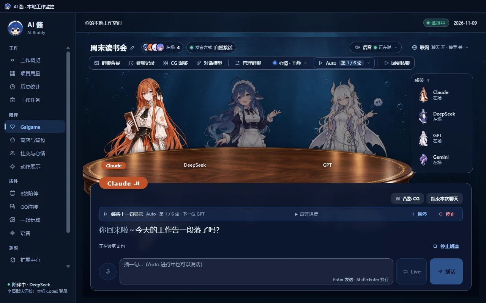

从 AI 酱 2.0.9 起，[一起玩牌](https://github.com/lXiaoSel1/AI-Buddy-Card-Games) 的声音菜单会多一条 **语音** 音量；牌桌上的文字等声音开始再显示，最多等 15 秒。

## MiniMax 云配音

在插件页把「在哪里配音」改成 **MiniMax 云端**，按提示新增一条云配音配置：名字、模型和你自己的 MiniMax API Key。Key 加密保存在这台电脑上，保存后不再显示；保存配置不会上传任何声音。AI 酱 2.0.14 起，新增配置时可以选 **地区**（中国大陆 / 国际），两个地区的 Key 不通用，换地区要重新填 Key；云配音的联网跟随 AI 酱 **通用设置 → 网络** 里的代理（需要语音插件 1.0.3）。

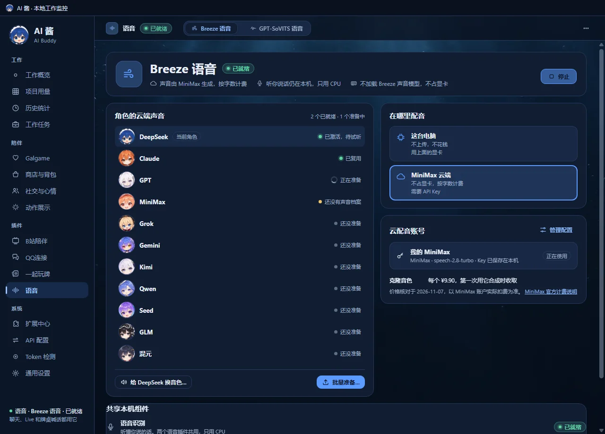

- **给角色换云端音色**：在这个 MiniMax 账号已有的系统音色、克隆音色和设计音色里搜索挑选，只改当前这位角色。

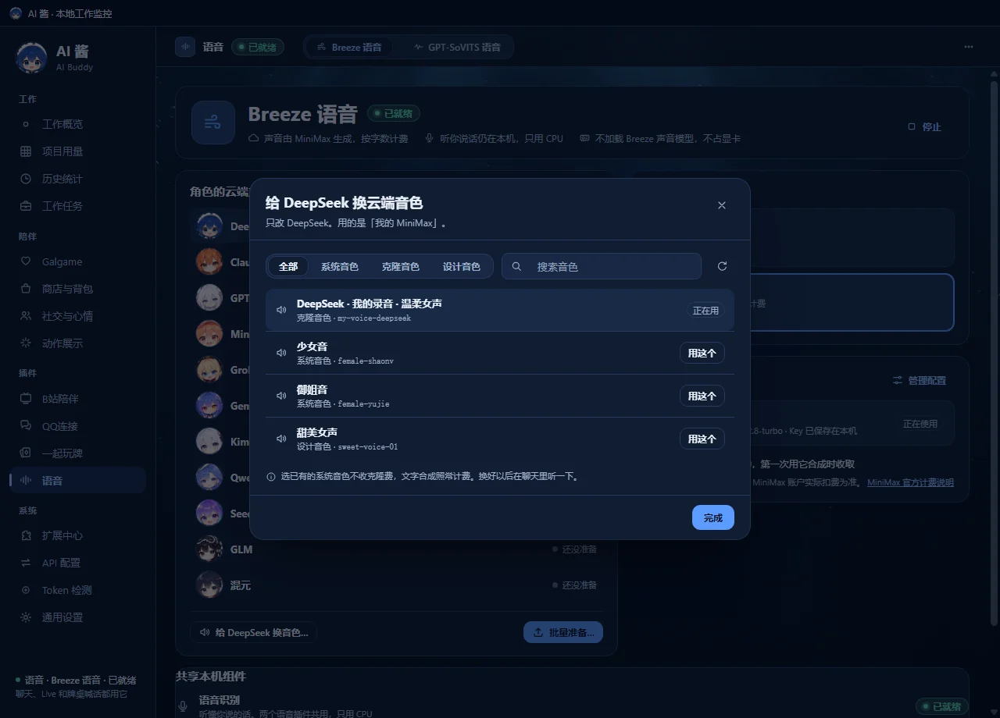

- **批量准备云端声音**：把几位角色的参考录音一次克隆成云端音色。开始之前会弹出确认窗口，列出要上传哪些角色、新克隆几个、大概多少钱。克隆的角色一开始都不勾选，只上传你明确选中并确认的那几位。
- **过期的云端音色**（AI 酱 2.0.14 起）：克隆的音色过期后，这位角色那一行会写「这个云端音色已经过期。」，点 **重新克隆…** 重新克隆一个，照样先弹出费用确认窗口。

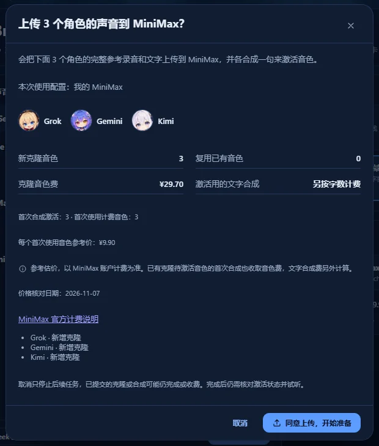

按 MiniMax 国内版官方定价，标准按量的克隆音色参考价为每个 ¥9.90，第一次用它合成时收取；文字合成另按 MiniMax 的字符计费规则算。一切以 MiniMax 账户的实际扣费和服务条款为准。取消只会停止后面的任务，已经提交的克隆或合成仍可能完成并收费。本机的参考录音不会自动变成同样的云端音色，要经过上面的确认上传。

## 下载与磁盘空间

插件包包含源码、固定的组件清单和已批准的 11 角色预制参考，来源与摘要见 [PRESET-SOURCES.md](PRESET-SOURCES.md)。声音模型、Python 环境和其他运行组件由 AI 酱按 `assets.json`、`downloads.json` 单独准备，本仓库不含这些大文件、用户个人参考录音或账户资料。下表是另行准备的运行组件，不含插件包本身。

| 组件 | 第一次下载 | 清单展开后 |
|---|---:|---:|
| 共用的语音识别和云配音组件 | 288,922,906 字节 | 432,623,440 字节 |
| Breeze 引擎 | 10,892,445,259 字节 | 12,882,035,341 字节 |
| GPT-SoVITS 引擎 | 6,628,886,611 字节 | 9,571,167,222 字节 |

第一次选 Breeze 加共用组件合计约 **11.18 GB**，GPT-SoVITS 加共用组件约 **6.92 GB**（十进制 GB）。已经核对过的组件会复用；下载和解压时还需要额外的临时空间。表中的下载量包含固定的上游模型权重和 FFmpeg，不只是我们镜像的运行组件分包。组件放在 AI 酱存档目录的 `voice/components/` 下。

## 数据与隐私

- 本机配音和语音识别都在这台电脑上完成，录音输入的声音不会发给语音云服务；发出识别出的文字时，和普通消息一样走这位角色的聊天连接。
- 你导入的参考录音保存在 AI 酱存档目录的 `voice/profiles/` 下，只给对应的角色用。
- 改用 MiniMax 云配音时，要读出来的文字会发给 MiniMax。参考录音只有在你明确同意云端克隆时才会上传（单个角色或批量都要确认），接口要求时还会附上用于校验的文字，可能产生费用。
- 语音组件按固定清单下载，并核对大小和 SHA-256。
- 插件包只带已批准的角色预制参考，不含用户个人录音或账号。全长云参考也只保存在本机，安装不会上传录音或创建 MiniMax 音色。

## 已知限制

- 本机配音需要 NVIDIA 显卡（CUDA）；显存不够时声音模型无法启动，可以改用 MiniMax 云配音（要用你自己的 Key，可能收费）。
- 发布后已在全新的隔离资料里验证过从目录发现插件、安装共用组件和 Breeze 插件、完整准备共用的语音识别组件；还没在全新的实体电脑上完整试用。
- 两套真实声音模型的加载和合成、MiniMax 计费、麦克风和长时间听感还没验收；牌桌上文字等声音的 15 秒上限，也还要按实际电脑校准。
- README 里的截图是用 AI 酱 2.0.9 的界面代码和演示数据拍的：语音状态由测试数据提供，没有加载声音模型，也没有连接 MiniMax。

## 技术说明

三个插件包：`ai-buddy.voice-breeze`、`ai-buddy.voice-gpt-sovits` 和内部共用的 `ai-buddy.voice-shared-runtime`，面向 Windows x64。清单写的是 AI Buddy >= 2.0.13，但 2.0.13 认不了 1.0.3（已撤回），实际要用 2.0.14 或更新的本体。三个包版本均为 1.0.3，两个引擎都精确依赖共用组件 1.0.3。AI 酱 2.0.14 按包版本的大版本号认语音包，支持语音接口大版本 1；以后的 1.x 版本 `appRange` 只写下限、至少 2.0.14，约定见 [语音插件接口兼容约定](https://github.com/lXiaoSel1/AI-Buddy/blob/main/docs/VOICE-PLUGIN-COMPATIBILITY.md)。两个引擎都装了时，升级计划会明确列出并一起更新它们和共用组件，保留原来的启停状态和各自的用户资料。

### 独立构建

安装 Node **24.21.0** 后，在源码目录执行，不需要 AI 酱本体、`npm install` 或 `node_modules`：

```console
node scripts/build.mjs --out=../voice-artifacts
```

输出目录必须是全新的，并且在源码仓库之外。构建生成三个插件 ZIP、对应的 `release-entry.json`，以及记录摘要、大小和源码信息的 `packages.json`。`release.json` 固定版本和 `publishedAt`，ZIP 内容按确定的顺序写入；相同的源码字节加上固定的 Node 版本，可以重复构建出相同的包。Git checkout 会记录提交和 tree；从不含 `.git` 的源码归档构建时，这两个字段为 null。

构建工具 `scripts/package-plugin.mjs` 和两个纯 Node SDK 文件 `src/plugin-archive.mjs`、`src/plugin-manifest.mjs` 直接复用自 AI Buddy 集成基线，来源和摘要见 [PROVENANCE.json](PROVENANCE.json)。构建会检查下载覆盖、清单绑定、包内容哈希和私密绝对路径；不会下载模型、启动 worker、调用云 API、签名或发布。正式的签名目录、公开资源可达性和安装后的模型、音频验收由发行流程另行记录。

## 来源和许可

包装代码采用 [LICENSE.md](LICENSE.md) 的 Apache-2.0 加 Commons Clause 条件。模型和第三方组件保留各自的条款，详见组件里的 `ASSET-NOTICES.md` 和资产清单。

- **Breeze**：模型、派生材料和自行部署生成的声音受 BreezeBlue Research and Non-Commercial License v1.1 约束，只限研究和非商业用途；商业用途需要另外取得 BreezeBlue 的书面商业许可。
- **GPT-SoVITS**：源码、预训练模型和依赖分别保留各自的条款。
- **FFmpeg**：使用固定的 [Gyan 8.1.2 full build 上游归档](https://github.com/GyanD/codexffmpeg/releases/download/8.1.2/ffmpeg-8.1.2-full_build.zip)，归档 SHA-256 为 `b8cdefab5f50590a076c27c2b56b0294a0e6154faded28ba1ba05ebc4f801f57`。AI 酱只提取并逐文件校验清单里的 `ffmpeg.exe`、`LICENSE` 和 `README.txt`，保留供应方的说明；AI 酱的资源分包不镜像 FFmpeg。这个技术准备方式不代表额外的法律授权结论。

## English

**Current version: 1.0.3** · requires [AI Buddy](https://github.com/lXiaoSel1/AI-Buddy) 2.0.14 or later. This is an official AI Buddy plugin; install it from **Extensions** inside AI Buddy, no separate download needed. After upgrading AI Buddy to 2.0.14, you can keep a compatible older plugin or update to 1.0.3 under **Extensions → Updates and maintenance**. AI Buddy 2.0.14 supports voice interface major version 1 without listing each patch version; 1.x plugins must still meet their minimum app version in `appRange` and pass compatibility and trust checks, including the interface and matching shared runtime version. 2.0.13 has been withdrawn; on it, 1.0.3 installs but cannot be enabled.

Let your AI Buddy characters talk. Her replies are read aloud in her own voice, with the text following the playback; you can also take turns talking with her in Live, or record a few sentences into text and edit them before sending. This repository holds the source of the two voice plugins, **Breeze Voice** and **GPT-SoVITS Voice**, which share one internal runtime.

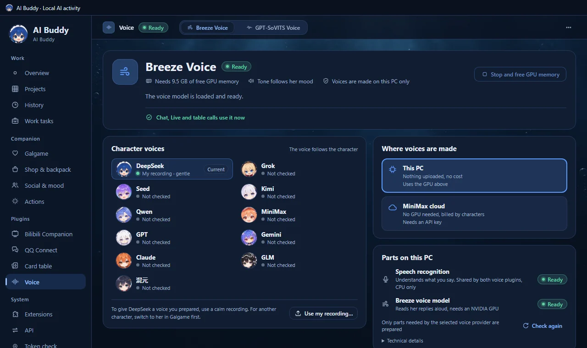

### What it does

- **Reads her replies aloud** in private chat, group chat and Card Games. A voiced reply appears in step with the actual playback and the part already read is dimmed; if voicing fails or times out, the text is shown anyway (the card table waits at most 15 seconds).
- **Live**: take turns talking. The strip shows four stages: you, recognizing, thinking, speaking.
- **Voice input**: the recognized text goes into the input box so you can edit it; nothing is sent automatically.
- **11 preset character voices**: each plugin imports its 11 presets on installation, preserving existing selections and custom recordings. You can also use a recording you prepared. It stays on this computer by default and is used only for that character; it is uploaded only if you explicitly agree to cloud cloning.
- **Local or cloud**: local voice uploads nothing and costs nothing; MiniMax cloud voice needs no GPU and is billed by characters.
- **Table calls**: in Card Games the characters call out things like "All in", and the sound menu has a separate voice volume.

### Which plugin

Install one, or both. They share the same speech recognizer, and only one local voice engine runs at a time; switching stops the current engine before starting the other. The GPU memory figures are start-up checks, not a promise that every computer can load the model.

| | Breeze Voice | GPT-SoVITS Voice |
|---|---|---|
| Tone | Follows her mood | Calm only |
| GPU | NVIDIA (CUDA), at least 9.5 GiB free memory at start | NVIDIA (CUDA), at least 4 GiB free memory at start |
| First download (including shared recognition, decimal GB) | about 11.18 GB | about 6.92 GB |
| Reference recording | A calm recording with only one person speaking | Same, 3–10 seconds |
| Use restriction | Model and generated voices for research and non-commercial use only; commercial use needs separate written permission; see [Sources and licenses](#sources-and-licenses) | See each component's notices |

Both can switch to **MiniMax cloud voice**, which prepares only the shared runtime and needs no local voice model or GPU.

### Quick start

1. **Install**: in AI Buddy open **Extensions → Discover** and click **Install…** next to Breeze Voice or GPT-SoVITS Voice. Including presets, the Breeze plugin is about 8 MB and GPT-SoVITS about 11 MB. Installation imports the corresponding 11 presets and preserves existing settings; the voice model is prepared the first time it starts.
2. **Open the voice page**: **Plugins → Voice** in the sidebar, or **Start** / **Open** on the **Installed** tab. Turning voice on in Galgame starts it too.
3. **Prepare parts**: the first time, parts on this PC show "Needs setup". Click **Download** to start; it shows progress and continues if you leave the page. Only the chosen engine and the shared recognizer are downloaded. From AI Buddy 2.0.12, if a plugin update keeps the same parts and their files are already on this PC, the row shows "Needs verification": click **Verify** next to **Download** instead and nothing is downloaded again. If verification finds a file missing or its content wrong, use **Download**; if it says verification was interrupted or files changed while verifying, click **Verify again**. AI Buddy 2.0.14 fixes verification failing although the files were fine; when a verification is cancelled or fails, files already checked are not checked again next time.
4. **(Optional) Use your recording**: switch to the character in Galgame, then choose **Use my recording…**, type exactly what is said, click **Use this recording** and pick a calm WAV with only one person speaking. GPT-SoVITS needs 3–10 seconds, a requirement of the model that AI Buddy does not check on import. Use only recordings you have the right to use. From AI Buddy 2.0.12, once a character has two or more voices, a **Her voice** menu appears to the left of **Use my recording…**, so you can switch back to the preset voice or to another recording at any time. If she is speaking, that sentence stops and the next one uses the new voice.
5. **Use it in chat**: **Voice** at the right of the Galgame top bar shows the state; click it to turn voice on or off and choose the plugin and where voices are made.

### Live and voice input

Click **Live** right of the input box: you say a line, she answers, and it is your turn again when she finishes. **End Live** ends Live without sending another message. Live and voice input need Windows to allow microphone access. After you click Live, the needed parts are prepared before the microphone opens and you can type meanwhile; while the voice model is loading, the Live button is disabled. If voicing fails or a reply cannot start, Live may end and you need to start it again; saved replies are kept. Switching between private and group chat, or leaving Galgame, never reopens the microphone for you. The microphone left of the input box records into an editable draft; cancelling keeps what you had typed.

### MiniMax cloud voice

Set "Where voices are made" to **MiniMax cloud** and add a configuration: name, model and your own MiniMax API key. The key is encrypted on this computer and never shown again; saving a configuration uploads no voices. From AI Buddy 2.0.14 a new configuration has a **Region** choice (Mainland China / International); keys are not shared between regions, so changing the region means entering that region's key, and cloud voice requests follow the proxy under **General settings → Network** (needs voice plugins 1.0.3). When a cloned voice has expired, its row says "This cloud voice has expired." and **Clone again…** makes a new clone after the same cost confirmation. You can change a character's cloud voice (searching the system, cloned or designed voices already in that MiniMax account), or prepare several characters at once. Bulk preparation shows a confirmation listing the characters to upload, the number of new clones and the estimated cost; no character is selected for paid cloning at first. Under MiniMax's official mainland pricing, the standard pay-as-you-go reference price is ¥9.90 per cloned voice, charged the first time it is used, and text synthesis is billed separately under MiniMax's character rules. Your MiniMax account's actual charges and terms are what count. Cancelling stops later steps only; work already submitted may still finish and be charged. A local reference does not automatically become the same cloud voice.

### Downloads and disk space

The plugin packages contain wrapper source, pinned inventories and the approved 11-character references documented in [PRESET-SOURCES.md](PRESET-SOURCES.md). AI Buddy prepares models, Python and other runtime components separately from `assets.json` and `downloads.json`; this repository contains no runtime archives, model weights, users' personal references or account data. The runtime totals below exclude the plugin packages themselves. Fresh Breeze plus shared components total about **11.18 GB**, GPT-SoVITS plus shared about **6.92 GB** (decimal GB; byte counts in the Chinese table above). Verified components are reused; downloading and extraction need extra temporary space. The totals include fixed upstream weights and FFmpeg. Components live under `voice/components/` in the AI Buddy data folder.

### Data and privacy

Local voice and speech recognition run on this computer, and voice input audio is not sent to a voice cloud service; text you send from it goes through the character's chat connection like any message. Imported references are stored under `voice/profiles/` and used only for their character. With MiniMax cloud voice, the text to be read is sent to MiniMax; references are uploaded only when you explicitly agree to cloud cloning (for one character or in bulk), with verification text when the API requires it, which may cost money. Components are downloaded from a pinned inventory and checked against their sizes and SHA-256. Only the approved character presets are bundled, with no users' personal recordings or accounts. Full cloud references also stay local; installing the plugin neither uploads audio nor creates a MiniMax voice.

### Known limitations

Local voice needs an NVIDIA GPU (CUDA). After release, catalog discovery, installing the shared parts and the Breeze plugin, and fully preparing the shared speech recognition were checked in a fresh isolated profile; a full trial on a fresh physical computer is still pending. Real loading and synthesis with both voice models, MiniMax billing, microphones and long listening sessions have not been accepted, and the card table's 15-second wait for audio still needs calibrating. The screenshots were taken with the AI Buddy 2.0.9 interface code and demo data: voice states come from test data, no voice model was loaded and MiniMax was not contacted.

### Technical notes

Three packages: `ai-buddy.voice-breeze`, `ai-buddy.voice-gpt-sovits` and the internal `ai-buddy.voice-shared-runtime`, for Windows x64. The manifests say AI Buddy >= 2.0.13, but 2.0.13 does not recognize 1.0.3 (it was withdrawn), so use 2.0.14 or later. All three packages are version 1.0.3; each engine requires shared runtime 1.0.3 exactly. AI Buddy 2.0.14 recognizes voice packages by the major version of the package version and supports voice interface major version 1; later 1.x releases declare `appRange` with a lower bound only, at least 2.0.14. See the [voice plugin interface compatibility rules](https://github.com/lXiaoSel1/AI-Buddy/blob/main/docs/VOICE-PLUGIN-COMPATIBILITY.en.md). When both engines are installed, the reviewed upgrade plan updates the installed group together and preserves enablement and independent user data.

With Node **24.21.0**, build from this checkout (no host checkout, npm installation or dependencies):

```console
node scripts/build.mjs --out=../voice-artifacts
```

Use a fresh output directory outside the repository. The build produces three plugin ZIPs, their `release-entry.json` files and `packages.json` with hashes, sizes and source information. `release.json` fixes the version and `publishedAt`, and ZIP entries are deterministic, so identical source bytes with the pinned Node version reproduce the archives. Git checkouts record the commit and tree; source archives without `.git` record null. The package tool and its two pure-Node SDK files come from the AI Buddy integration baseline; [PROVENANCE.json](PROVENANCE.json) records their source and hashes. Building checks download coverage, inventory binding, archive hashes and private absolute paths; it does not download models, start workers, call cloud APIs, sign or publish.

### Sources and licenses

Wrapper code is under the Apache-2.0 plus Commons Clause terms in [LICENSE.md](LICENSE.md). Models and third-party components keep their own terms in the component `ASSET-NOTICES.md` files and inventories. **Breeze** model materials, derivatives and self-hosted outputs carry the BreezeBlue Research and Non-Commercial License v1.1: research and non-commercial use only; commercial use needs a separate written commercial license from BreezeBlue. **GPT-SoVITS** source, pretrained materials and dependencies keep their respective notices. **FFmpeg** comes from the fixed [Gyan 8.1.2 full-build upstream archive](https://github.com/GyanD/codexffmpeg/releases/download/8.1.2/ffmpeg-8.1.2-full_build.zip) (SHA-256 above); AI Buddy extracts and verifies only the inventoried `ffmpeg.exe`, `LICENSE` and `README.txt`, and its runtime parts do not mirror FFmpeg. This preparation path makes no separate legal authorization claim.
